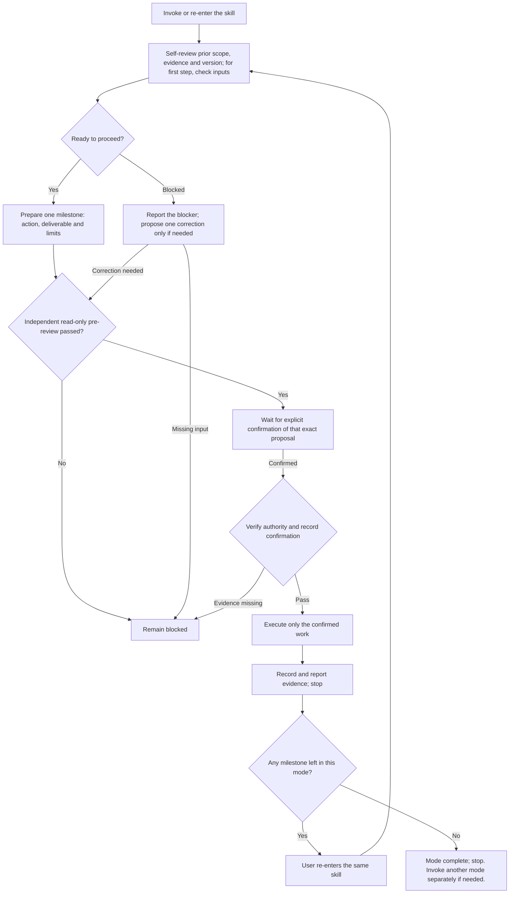

# Let's Grunt

English · [简体中文](README.zh-CN.md)

Plan before touching the tree. Review the skeleton before writing business logic. Let's Grunt provides four workflow skills and an optional read-only reviewer. Use a host that can load skill instructions and access the bundled workflow within the project's permissions.

## Optional driver

[Driver prompt conversion](driver/lg-drive/SKILL.md) is a separate coordinator-side skill, not part of the five executor entries. Apply it automatically before each outbound project-task prompt. The owner can speak casually; facts and permissions are preserved, only material decisions are asked, and deliberate ambiguity tests stay ambiguous. Nothing is activated in a host merely by installing the main package.

## Main flow

Open Plan or Spec in the target project. Supply the project root if the host cannot verify it. Executors and independent reviewers limit reads, searches and writes to the permitted project paths. For necessary outside access, provide the exact path, purpose and narrowest scope and wait for the project initiator's explicit approval. Set a file access policy that scopes reads as well as writes.

**OpenCode**: Open `/agents`, select **Plan**, and verify the active agent before loading `lg-plan` and submitting the request. API callers explicitly select `plan` and verify the actual agent. Skill loading and agent selection leave filesystem limits and step approvals in force. For a Spec or Build handoff, select the appropriate native agent manually if needed before invoking the next skill. Check the effective model if the selected agent has its own model configured. [OpenCode TUI](https://opencode.ai/docs/cli/tui/) · [Agent configuration](https://opencode.ai/docs/agents)

For a handoff, use the next skill's entry verified in the current host. Codex uses `$lg-spec` or `$lg-build`. OpenCode uses `@lg-spec` or `@lg-build` when the native picker lists that skill. A skill selection is separate from an OpenCode slash command. In DSH use the short command that is actually registered. Other supported entries can be used if the current host verifies them. If there is no verified entry, ask the user to load the named skill manually in plain language.

**Plan 1–3 → Spec 4–9 → Build 10–17 → stop at delivery.** Invoke each mode separately. Nothing is published or deployed by completing the main flow.

| Invoke in Codex | Does | Does not |
| --- | --- | --- |
| `$lg-plan` | Explore goals, scope, and tradeoffs read-only | Write files or dispatch work |
| `$lg-spec` | Design architecture, API/UI, data/DDL, and test methods in authorized docs | Write implementation, tests, configuration, or executable migrations |
| `$lg-build` | Build the authorized slice from a pinned spec. Design the skeleton, then independently review executable stubs before business logic | Skip independent review or assume permission to push or release |

Plan decides the mode and who can confirm each step. **Authorization mode** is the default. **Trust mode** can route confirmations to pre-authorized people or a delegated independent AI. Both wait for a fresh exact-step confirmation and any required quorum. Platform permissions and independent acceptance still apply. On Codex hosts that honor `agents/openai.yaml`, Spec, Build, Refine, and Review are explicit-invocation only. Plan uses the host default. Use the host's filesystem controls to limit where tools can read and write. Read-only mode alone can still allow reads outside the project.

See the [20 milestones and self-review gate](skills/lg-spec/references/WORKFLOW.md#numbered-milestones). Before proposing the next number, the agent checks the previous scope, evidence, exact version and gaps. Missing material evidence blocks progression; self-review does not replace independent review.

Split frontend interaction and backend behavior only when it helps. Pin a minimal shared contract, disjoint ownership and an integration owner. A work split does not imply separate deployment. Verify the highest-risk real scenario on the integrated candidate; a mock or a separately passing component is not product acceptance. See [risk-based delivery examples](examples/risk-based-delivery.md) for client, service, migration and routine changes.

Plan #3 hands the next agent a short, actionable brief: verified goal and limits, sequenced work packages, owner roles, deliverables and pass evidence, open gates and the smallest next step. It is not a spec and writes no files.

Before asking a person to confirm, the executor self-checks and obtains independent read-only review of the exact evidence and proposal. Use a verifiable independent session or human reviewer with the required scope. A missing or failed review blocks the request. Step confirmation and final acceptance still require their own evidence.

## How numbered steps advance

Plan and Spec show the in-scope design and confirmed choices first. Answer material tradeoffs at the end under **Needs your decision**, in a native question card when available. Reversible defaults appear in the design. Step authorization, initiator confirmation and missing evidence get separate labels when needed. Required replies hold only the dependent work. The completed phase ends with one manual next-step hint.

Plan has **3** milestones, Spec **6**, Build **8**, and Refine **3**. The diagram below shows Authorization mode. Trust mode follows the same numbered steps, but after self-review it requests fresh confirmation from eligible confirmers without requiring owner re-entry. In Authorization mode, once a confirmed milestone finishes, call the **same skill again** to work toward its next milestone. Start another mode only by calling it separately.



In text: review the previous result (or first-step inputs), prepare one step, obtain independent pre-review, wait, execute only that step, report and stop. A failed or missing check blocks progress; ask only about a named correction if new execution is needed. A clear confirmation of the exact pending step is enough; don't ask twice.

Record the human policy grantor and each step’s actual eligible confirmer, authority, original evidence and time. A standing grant alone is not confirmation; missing evidence blocks execution.

For example, in Authorization mode on Codex, once the product spec is ready, invoke `$lg-spec` again. The agent proposes **architecture only** and waits. After confirmation, the agent delivers that step and stops. Call `$lg-spec` again for the next milestone. When Spec is frozen, invoke `$lg-build` separately.

## Optional branches

- **Small compatible change (18–20):** Load `lg-refine` for a bounded change such as clearer help text. Return to `lg-spec` for a contract change.
- **Independent review on demand:** In an independent session, load [`lg-review`](skills/lg-review/SKILL.md) (`$lg-review` in Codex) with the pinned candidate, SPEC, authorized paths, acceptance IDs and evidence. Confirm the candidate, read scope and report before inspection. It reports what is complete, failed, blocked or unverified. Build's independent runtime review and acceptance are separate.
- **Release or operations, only if needed after step 17:** A production deployment is a separate action, not part of delivery. Confirm the exact candidate, target, verification, and rollback before proceeding.

## Key documents

| Document | When to use it |
| --- | --- |
| [WORKFLOW.md](skills/lg-spec/references/WORKFLOW.md) | Shared rules, numbered steps, authority and evidence gates across the skills. |
| [CHANGE.md](skills/lg-spec/references/CHANGE.md) | Handoff template for a scoped change: what changed, who owns it, which regression checks ran, and what remains. |
| [REVIEW_LOG.md](skills/lg-spec/references/REVIEW_LOG.md) | Template only. The authoritative review results live in the project's existing authorized evidence record, or in an explicitly authorized `docs/REVIEW_LOG.md`. Link to that one record from step or module status. |
| [VALIDATION.md](VALIDATION.md) | Local package checks, evidence limits and what was not verified in a live session. |

## Install and remove

Copy all five directories from [skills](skills) into a skill root active for the target project. Preserve `agents/` and both bundled workflow resources.

| Host | Project skill root |
| --- | --- |
| Codex | `.agents/skills/` under the target project. A user-level install can use `~/.agents/skills/`. |
| OpenCode | `.opencode/skills/` under the target project. Discovery starts at the actual working directory and walks up to the project root. Check compatibility roots too if a skill resolves to the wrong copy. |
| Other | Use a skill root the current host confirms. Verify discovery and permissions before trying Plan. |

Use one active copy. The following macOS or Linux example uses the Codex user-level root. For a project installation, set `dest` to the absolute path of its skill directory from the table.

```sh
(
  set -eu
  dest="$HOME/.agents/skills"
  for n in lg-plan lg-spec lg-build lg-refine lg-review; do
    if [ -e "$dest/$n" ] || [ -L "$dest/$n" ]; then
      printf 'Already exists; not overwriting: %s\n' "$dest/$n" >&2
      exit 1
    fi
  done
  mkdir -p "$dest"
  for n in lg-plan lg-spec lg-build lg-refine lg-review; do
    cp -R "skills/$n" "$dest/"
  done
)
```

Open the target project in the host and check that each skill resolves to the intended copy, then try Plan in a disposable project. See [Codex Skills](https://developers.openai.com/codex/skills) and [OpenCode Skills](https://opencode.ai/docs/skills/) for their discovery and permission rules.

To remove or upgrade, move only the five installed folders out of the search path into a new backup directory. Do not delete the whole skills root. Older tools are not modified or removed by this package.

## If a skill does not show up

- Check the active project and working directory, then look up the skill in the host's skill picker or inventory. In OpenCode, look for the skill entry rather than a slash command. Check that each skill directory directly contains its `SKILL.md`.
- If the skill resolves to the wrong copy, inspect the host's project and user skill roots and its permission settings. Use one active copy of the intended version.
- If Plan cannot load its workflow, restore its bundled `lg-plan/references/WORKFLOW.md` or supply a verified in-project copy matching the digest in the Plan entry. Maintain the canonical copy in `lg-spec/references/WORKFLOW.md`. Run `python3 -B scripts/check.py --sync-plan-workflow` after changing or repackaging it.

## Try it on a tiny CLI

Enter these as separate Codex messages, not shell commands:

1. `$lg-plan Plan a local title-to-slug CLI with no network or persistence. Do not write files.`
2. `$lg-spec Write only docs/SPEC.md: CLI input/output, errors, acceptance, and developer/reviewer handoff.`
3. `$lg-build From the pinned CLI specification, propose only the skeleton design (step 10).` Re-enter separately for stubs, review, implementation, developer checks, independent review/retest, acceptance and delivery.
4. `$lg-refine Propose the scope of a test-message improvement without changing observable CLI behavior.` After that round, re-enter once for the change and once for regression.

The [sample skeleton and acceptance matrix](examples/slug-skeleton/README.md) demonstrate what to inspect before business implementation. Run the package and example checks with:

```sh
python3 scripts/check.py
```

At acceptance, record the tested revision, where and how to verify it, pass criteria and what was untested. `python3 scripts/check.py` checks package structure and synthetic fixtures. Live host behavior, including card delivery, agent selection and skill invocation, requires separate evidence from that host.

For a nontrivial change across sessions, use the [CHANGE.md template](skills/lg-spec/references/CHANGE.md) to record pinned inputs, review evidence, and the next eligible step in an authorized docs path. Tiny same-session changes need no extra file. Pass only pinned references, hard constraints and needed evidence across contexts; a reviewer should not inherit the full chat or developer verdict.

See the [validation record](VALIDATION.md) for prior runs and their coverage. See the [release checklist](RELEASE-CHECKLIST.md) for maintainer checks.

## License

[MIT](LICENSE).
