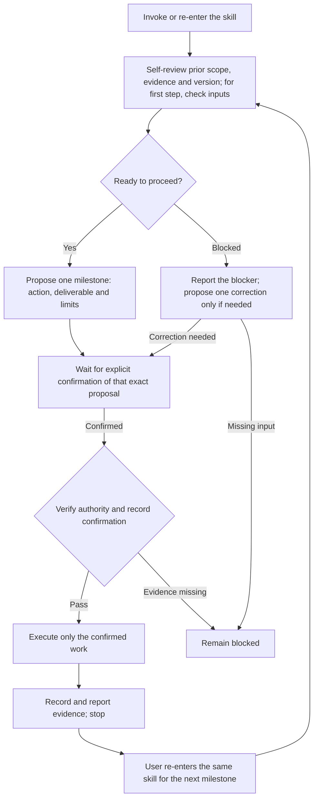

# Let's Grunt

English · [简体中文](README.zh-CN.md)

Plan before touching the tree. Review the skeleton before writing business logic. Let's Grunt is a set of four Codex skills for projects that need explicit scope, documented contracts, and independent acceptance.

| Invoke in Codex | Does | Does not |
| --- | --- | --- |
| `$lg-plan` | Explore goals, scope, and tradeoffs read-only | Write files or dispatch work |
| `$lg-spec` | Design architecture, API/UI, data/DDL, and test methods in authorized docs | Write implementation, tests, configuration, or executable migrations |
| `$lg-build` | Build the authorized slice from a pinned spec. Design the skeleton, then independently review executable stubs before business logic | Skip independent review or assume permission to push or release |
| `$lg-refine` | Make a bounded, compatible change and run focused regression checks | Change the contract or silently expand scope |

Use each mode separately. The agent proposes one concrete next step and its deliverable and limits, waits for your explicit confirmation, executes only that step, then reports evidence and pauses again. Calling a skill or approving the overall plan does not approve its steps. On Codex hosts that honor `agents/openai.yaml`, Spec, Build, and Refine are explicit-invocation only. Plan uses the host default. This setting governs skill selection, not filesystem access; use the host's read-only sandbox for a stronger guarantee when planning.

See the [20 milestones and self-review gate](skills/lg-spec/references/WORKFLOW.md#numbered-milestones). Before proposing the next number, the agent checks the previous scope, evidence, exact version and gaps. Missing material evidence blocks progression; self-review does not replace independent review.

## Every skill takes multiple rounds

Plan has **3** milestones, Spec **6**, Build **8**, and Refine **3**. A call does not run a whole mode. Once a confirmed milestone finishes, call the **same skill again** to work toward its next milestone. Start another mode only by calling it separately.



In text: review the previous result (or first-step inputs), propose one step, wait, execute only that step, report and stop. A failed or missing check blocks progress; ask only about a named correction if new execution is needed. A clear confirmation of the exact pending step is enough; don't ask twice.

In multi-person work, verify the approver’s identity and authority and record the exact confirmation before acting. If the evidence or authorized audit record is missing, stay blocked.

For example, once the product spec is ready, invoke `$lg-spec` again. The agent proposes **architecture only** and waits. Confirm that exact architecture step; the agent delivers it and stops. Call `$lg-spec` again for the next milestone. When Spec is frozen, invoke `$lg-build` separately.

## Install and remove

Inspect the four directories under [skills](skills) and their [shared workflow](skills/lg-spec/references/WORKFLOW.md). From the unpacked package directory on macOS or Linux:

```sh
(
  set -eu
  dest="$HOME/.agents/skills"
  for n in lg-plan lg-spec lg-build lg-refine; do
    if [ -e "$dest/$n" ] || [ -L "$dest/$n" ]; then
      printf 'Already exists; not overwriting: %s\n' "$dest/$n" >&2
      exit 1
    fi
  done
  mkdir -p "$dest"
  for n in lg-plan lg-spec lg-build lg-refine; do
    cp -R "skills/$n" "$dest/"
  done
)
```

For a project-only install, use the target repository's absolute `.agents/skills` path instead. Do not install in both scopes. Copy all four folders together, including `agents/` and `lg-spec/references/WORKFLOW.md`. In a fresh Codex session, check that each name appears once, then try Plan in a disposable project. See [Codex Skills](https://developers.openai.com/codex/skills) for discovery and policy details and the [Agent Skills specification](https://agentskills.io/specification) for the file format. The four skills are a bundle, not standalone packages. Codex is the target; other clients are not covered by these checks.

To remove or upgrade, move only the four installed folders out of the search path into a new backup directory. Do not delete the whole skills root. Older tools are not modified or removed by this package.

## If a command does not show up

- Start a fresh Codex session in the project where you want to use the skill. Check that each exact folder contains its matching `SKILL.md`. Do not nest the package root itself under the skills path.
- If a command appears twice, check the user skill directory, the project skill directory, and enabled plugins for the same name. Keep only the intended copy.
- If a command reports a missing workflow, restore `lg-spec/references/WORKFLOW.md` and install the four folders as siblings. Do not copy rules into the project or bypass the gate.

## Try it on a tiny CLI

Enter these as separate Codex messages, not shell commands:

1. `$lg-plan Plan a local title-to-slug CLI with no network or persistence. Do not write files.`
2. `$lg-spec Write only docs/SPEC.md: CLI input/output, errors, acceptance, and developer/reviewer handoff.`
3. `$lg-build Implement only this CLI slice from the pinned docs/SPEC.md revision. First propose the skeleton sketch; separately confirm runnable stubs and independent review before implementing logic.`
4. `$lg-refine Improve an existing test failure message without changing any externally visible CLI behavior.`

The [sample skeleton and acceptance matrix](examples/slug-skeleton/README.md) demonstrate what to inspect before business implementation. Run the package and example checks with:

```sh
python3 scripts/check.py
```

For a nontrivial change across sessions, use the [CHANGE.md template](skills/lg-spec/references/CHANGE.md) to record pinned inputs, review evidence, and the next eligible step in an authorized docs path. Tiny same-session changes need no extra file. Pass only pinned references, hard constraints and needed evidence across contexts; a reviewer should not inherit the full chat or developer verdict.

See [verification results](VALIDATION.md) for what this candidate actually tested. See the [release checklist](RELEASE-CHECKLIST.md) for maintainer checks.

## License

[MIT](LICENSE).
