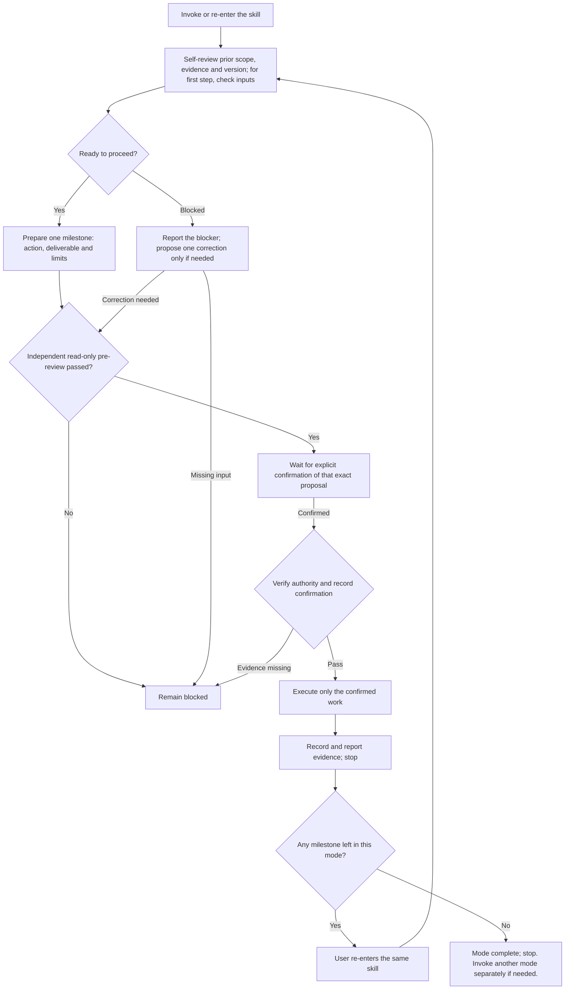

# Let's Grunt

English · [简体中文](README.zh-CN.md)

Plan before touching the tree. Review the skeleton before writing business logic. Let's Grunt is a set of four Codex workflow skills with an optional read-only companion reviewer for projects that need explicit scope, documented contracts, and independent acceptance.

## Main flow

**Plan 1–3 → Spec 4–9 → Build 10–17 → stop at delivery.** Invoke each mode separately. Nothing is published or deployed by completing the main flow.

| Invoke in Codex | Does | Does not |
| --- | --- | --- |
| `$lg-plan` | Explore goals, scope, and tradeoffs read-only | Write files or dispatch work |
| `$lg-spec` | Design architecture, API/UI, data/DDL, and test methods in authorized docs | Write implementation, tests, configuration, or executable migrations |
| `$lg-build` | Build the authorized slice from a pinned spec. Design the skeleton, then independently review executable stubs before business logic | Skip independent review or assume permission to push or release |

Plan decides the mode and who can confirm each step. **Authorization mode** is the default; **Trust mode** can route confirmations to pre-authorized people or a delegated independent AI. Both wait for a fresh exact-step confirmation and any required quorum. For example, choose a designated maintainer, any authorized project member, or a maintainer plus a delegated independent AI. None can replace human platform permissions or independent acceptance. On Codex hosts that honor `agents/openai.yaml`, Spec, Build, Refine, and Review are explicit-invocation only. Plan uses the host default. This setting governs skill selection, not filesystem access; use the host's read-only sandbox for a stronger guarantee when planning.

See the [20 milestones and self-review gate](skills/lg-spec/references/WORKFLOW.md#numbered-milestones). Before proposing the next number, the agent checks the previous scope, evidence, exact version and gaps. Missing material evidence blocks progression; self-review does not replace independent review.

Plan #3 hands the next agent a short, actionable brief: verified goal and limits, sequenced work packages, owner roles, deliverables and pass evidence, open gates and the smallest next step. It is not a spec and writes no files.

Before asking a person to confirm, the executor self-checks and an independent read-only subagent reviews the exact evidence and proposal. A missing or failed review blocks the request. This review does not count as confirmation or final acceptance.

## How numbered steps advance

Plan has **3** milestones, Spec **6**, Build **8**, and Refine **3**. The diagram below shows Authorization mode. Trust mode follows the same numbered steps, but after self-review it requests fresh confirmation from eligible confirmers without requiring owner re-entry. In Authorization mode, once a confirmed milestone finishes, call the **same skill again** to work toward its next milestone. Start another mode only by calling it separately.



In text: review the previous result (or first-step inputs), prepare one step, obtain independent pre-review, wait, execute only that step, report and stop. A failed or missing check blocks progress; ask only about a named correction if new execution is needed. A clear confirmation of the exact pending step is enough; don't ask twice.

Record the human policy grantor and each step’s actual eligible confirmer, authority, original evidence and time. A standing grant alone is not confirmation; missing evidence blocks execution.

For example, in Authorization mode, once the product spec is ready, invoke `$lg-spec` again. The agent proposes **architecture only** and waits. Confirm that exact architecture step; the agent delivers it and stops. Call `$lg-spec` again for the next milestone. When Spec is frozen, invoke `$lg-build` separately.

## Optional branches

- **Small compatible change (18–20):** Invoke `$lg-refine` for a bounded change such as clearer help text without changing behavior. If a contract needs to change, return to `$lg-spec` instead.
- **Independent review on demand:** In a new, independent Codex agent/session, invoke [`$lg-review`](skills/lg-review/SKILL.md) with the pinned candidate, SPEC, authorized paths, acceptance IDs and evidence. For standalone review, confirm the proposed candidate, read scope and report before inspection. It checks what is complete, failed, blocked or not run, and gives a way to verify the gaps. It neither changes the project nor runs its tests. It adds no milestone and cannot replace Build's independent runtime review or acceptance.
- **Release or operations, only if needed after step 17:** A production deployment is a separate action, not part of delivery. Confirm the exact candidate, target, verification, and rollback before proceeding.

## Install and remove

Inspect the five directories under [skills](skills) and their [shared workflow](skills/lg-spec/references/WORKFLOW.md). From the unpacked package directory on macOS or Linux:

```sh
(
  set -eu
  dest="$HOME/.agents/skills"
  for n in lg-plan lg-spec lg-build lg-refine lg-review; do
    if [ -e "$dest/$n" ] || [ -L "$dest/$n" ]; then
      printf 'Already exists; not overwriting: %s\n' "$dest/$n" >&2
      exit 1
    fi
  done
  mkdir -p "$dest"
  for n in lg-plan lg-spec lg-build lg-refine lg-review; do
    cp -R "skills/$n" "$dest/"
  done
)
```

For a project-only install, use the target repository's absolute `.agents/skills` path instead. Do not install in both scopes. Copy all five folders together, including `agents/` and `lg-spec/references/WORKFLOW.md`. In a fresh Codex session, check that each name appears once, then try Plan in a disposable project. See [Codex Skills](https://developers.openai.com/codex/skills) for discovery and policy details and the [Agent Skills specification](https://agentskills.io/specification) for the file format. The five installed skills are a bundle, not standalone packages. Codex is the target; other clients are not covered by these checks.

To remove or upgrade, move only the five installed folders out of the search path into a new backup directory. Do not delete the whole skills root. Older tools are not modified or removed by this package.

## If a command does not show up

- Start a fresh Codex session in the project where you want to use the skill. Check that each exact folder contains its matching `SKILL.md`. Do not nest the package root itself under the skills path.
- If a command appears twice, check the user skill directory, the project skill directory, and enabled plugins for the same name. Keep only the intended copy.
- If a command reports a missing workflow, restore `lg-spec/references/WORKFLOW.md` and install the five folders as siblings. Do not copy rules into the project or bypass the gate.

## Try it on a tiny CLI

Enter these as separate Codex messages, not shell commands:

1. `$lg-plan Plan a local title-to-slug CLI with no network or persistence. Do not write files.`
2. `$lg-spec Write only docs/SPEC.md: CLI input/output, errors, acceptance, and developer/reviewer handoff.`
3. `$lg-build From the pinned CLI specification, propose only the skeleton design (step 10).` Re-enter separately for stubs, review, implementation, developer checks, independent review/retest, acceptance and delivery.
4. `$lg-refine Propose the scope of a test-message improvement without changing observable CLI behavior.` After that round, re-enter once for the change and once for regression.

The [sample skeleton and acceptance matrix](examples/slug-skeleton/README.md) demonstrate what to inspect before business implementation. Run the package and example checks with:

```sh
python3 scripts/check.py
```

At acceptance, you should get the tested revision, where and how to verify it, what counts as a pass or a failure, and what was not tested. For example: from the pinned Let's Grunt checkout with Python 3 installed, run `python3 scripts/check.py`. All required local fixtures must run and pass; an error or a skipped required case is not a pass. This does not test live Codex behavior.

For a nontrivial change across sessions, use the [CHANGE.md template](skills/lg-spec/references/CHANGE.md) to record pinned inputs, review evidence, and the next eligible step in an authorized docs path. Tiny same-session changes need no extra file. Pass only pinned references, hard constraints and needed evidence across contexts; a reviewer should not inherit the full chat or developer verdict.

See [verification results](VALIDATION.md) for what this candidate actually tested. See the [release checklist](RELEASE-CHECKLIST.md) for maintainer checks.

## License

[MIT](LICENSE).
