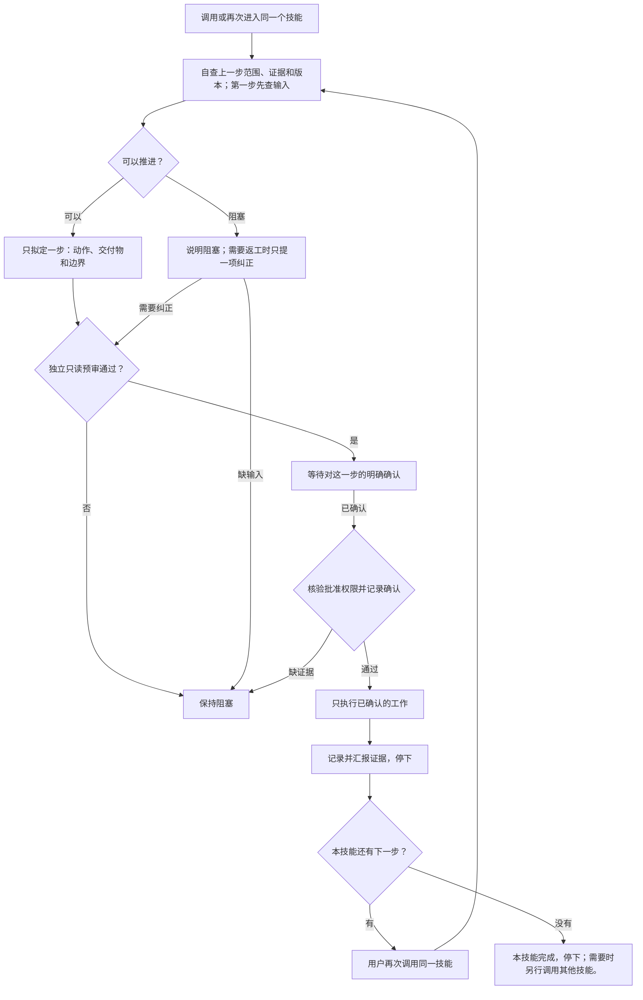

# Let's Grunt

[English](README.md) · 简体中文

先规划，再动工作区。先复核骨架，再写业务逻辑。Let's Grunt 提供四个工作流技能和一个可选的只读复核技能，适用于能加载技能并在项目授权范围内读取共用工作流的工具。

## 可选驱动层

[驱动提示词转换技能](driver/lg-drive/SKILL.md)由协调者在每次派发项目任务前自动应用，不是新增工作阶段，也不随五个执行技能隐式安装。用户可以用自然语言说个大概；驱动器保留实际事实和权限，只反问重要取舍。

## 主流程

在目标项目中打开 Plan 或 Spec。工具无法核验项目根目录时，再提供路径。执行者和独立评审都只在获准的项目范围内读、查、写。确需访问项目外路径时，先说明确切路径、用途和最小范围，等项目发起人明确批准。用工具的文件访问范围限制读取，单开只读模式无法限制扫描范围。

**OpenCode**：先用 `/agents` 手动选择 **Plan**，确认当前 agent 后再加载 `lg-plan` 并提交请求。通过 API 时，显式选择 `plan` 并核验实际 agent。技能附件只提供指令，文件权限和步骤授权仍须核验。进入 Spec 或 Build 前，如需更换原生 agent，由开发者先手动选择，再调用对应技能。切换后的 agent 若有自己的模型配置，请核对实际模型。 [OpenCode 终端用法](https://opencode.ai/docs/cli/tui/) · [Agent 配置](https://opencode.ai/docs/agents)

切换阶段时，使用当前宿主已核验的技能入口。Codex 用 `$lg-spec` 或 `$lg-build`。OpenCode 的原生技能选择器确实列出该技能时，用 `@lg-spec` 或 `@lg-build`。OpenCode 的技能选择和斜杠命令是不同入口。DSH 用实际已注册的短命令。其他工具以当前宿主明确支持的入口为准，无法核验时只提示手动加载指定技能。

**Plan 1–3 → Spec 4–9 → Build 10–17 → 交付即停。** 每种模式单独调用。主流程完成后不会自动发布或部署。

| 在 Codex 中调用 | 做什么 | 不做什么 |
| --- | --- | --- |
| `$lg-plan` | 只读讨论目标、范围和取舍 | 不写文件，不派发执行 |
| `$lg-spec` | 在授权文档设计架构、API/界面、数据/DDL 和测试方法 | 不写实现、测试、配置或可执行迁移 |
| `$lg-build` | 按锁定的规格实现授权切片，先设计骨架，再独立复核可运行的空函数 | 不跳过独立复核，不把执行权限当成推送或发布权限 |

Plan 核对采用**授权模式**（默认）还是**信任模式**，以及每步由谁确认、需要几人。两种模式都须收到针对当步的实际确认。信任模式可以让事先获准的人或独立 AI 确认，平台权限和独立验收仍然适用。支持 `agents/openai.yaml` 的 Codex 上，Spec、Build、Refine 和 Review 需要显式调用，Plan 保持宿主默认。要限制目录访问，须使用能约束读取和写入范围的文件权限。只读模式仍可能读取项目外文件。

见 [20 步清单及自查规则](skills/lg-spec/references/WORKFLOW.md#numbered-milestones)。提出下一编号前，代理先核对上一步的范围、证据、准确版本和缺口。缺少关键证据就停下；自查不代替独立复核。

Build 按需拆前端交互和业务实现：先锁最小接口、分清文件归属与联调负责人，能并行就并行，不默认拆部署。现有步骤确认和独立复核不变。优先实测最容易让交付失败的场景；单边通过或仅跑通模拟数据，不算整条链路验收。 [按风险选验收证据的例子](examples/risk-based-delivery.md)涵盖客户端、并发服务、迁移和低风险改动。

Plan 第 3 步交接给下一个代理：已验证的目标和边界、按依赖排序的工作包、负责角色、交付物与通过证据、未过关卡和最小下一步。它不是 SPEC，也不写文件。

向人请求确认前，执行者先自查，再由可核验的独立只读会话或人工评审核对同版证据和本步提案。缺少合格的复核结果就暂停请求。步骤确认和最终验收分别留证。

## 编号步骤如何推进

Plan 和 Spec 先展示本轮设计正文和已确定事项。重要取舍放在末尾的 **需要你决定**，工具支持时可直接在原生问答卡作答。可逆细节在正文说明默认做法。步骤授权、发起人确认和待补证据按需单列。有必答项时只暂停依赖它的工作，阶段完成后最后一行给出手动下一步。

Plan 有 **3** 步，Spec **6** 步，Build **8** 步，Refine **3** 步。下图展示授权模式。信任模式沿用相同编号与自查规则，只是可向合格的确认者发起确认，不必等所有者重新调用。在授权模式下，已确认的一步做完并停下后，请**再次调用同一个技能**推进下一步。要切换模式，另行调用。



文字版：先自查上一步（第一步查输入），拟定一步，独立预审通过后等确认，只执行这一项，汇报证据并停下。关键检查失败或缺证据就不推进；需要执行新动作时，只确认具体纠正项。对同一待执行步骤明确确认一次即可，不重复问。

分别记录设置规则的人和实际逐步确认者，以及权限、原始凭据和时间。只有预先授权、没有本步确认，不执行。

以 Codex 的授权模式为例，产品规格做好后再调用 `$lg-spec`。代理只提出**架构设计**这一步，等你确认。做完架构就汇报并停下。再次调用 `$lg-spec` 才推进下一步。Spec 冻结后另行调用 `$lg-build`。

## 按需分支

- **兼容的小改动（18–20）**。用 `lg-refine` 处理范围明确的小改动，例如优化帮助文字。涉及契约变更时回到 `lg-spec`。
- **按需独立复核**。在独立会话加载 [`lg-review`](skills/lg-review/SKILL.md)（Codex 用 `$lg-review`），提供锁定版本、SPEC、授权路径、验收项和证据。确认候选、读取范围和报告后再检查。结果区分已验证、未通过、受阻和未验证。Build 的独立复测和验收另行完成。
- **发布或运维：** 只有第 17 步完成后、确有上线需求时才另行处理。交付不等于上线；行动前单独确认版本、目标环境、验证方法和回滚方案。

## 关键文档

| 文档 | 什么时候看 |
| --- | --- |
| [WORKFLOW.md](skills/lg-spec/references/WORKFLOW.md) | 查看各技能共用的规则、编号步骤、授权和证据要求。 |
| [CHANGE.md](skills/lg-spec/references/CHANGE.md) | 小范围变更的交接模板：改了什么、谁负责、跑了哪些回归、还剩什么。 |
| [REVIEW_LOG.md](skills/lg-spec/references/REVIEW_LOG.md) | 这是模板。正式复核结果记录在项目已有的授权证据记录里；没有时，可在明确授权后用 `docs/REVIEW_LOG.md`。步骤或模块状态只需链接到这一份记录。 |
| [VALIDATION.md](VALIDATION.md) | 查看本地检查覆盖了什么、证据的边界，以及哪些行为没有在实际会话中验证。 |

## 安装与移除

把[五个技能目录](skills)一起复制到目标项目生效的技能路径，保留 `agents/` 和两份配套工作流。

| 宿主 | 项目技能路径 |
| --- | --- |
| Codex | 目标项目下的 `.agents/skills/`。用户级可以使用 `~/.agents/skills/`。 |
| OpenCode | 目标项目下的 `.opencode/skills/`。从实际工作目录向上发现至项目根，来源不对时也检查兼容路径。 |
| 其他工具 | 使用当前宿主确认生效的技能路径，核验技能发现和权限后再试 Plan。 |

每个技能只保留一份生效副本。下面是 macOS 和 Linux 上 Codex 用户级安装的示例。项目级安装时把 `dest` 设为表中技能目录的绝对路径。

```sh
(
  set -eu
  dest="$HOME/.agents/skills"
  for n in lg-plan lg-spec lg-build lg-refine lg-review; do
    if [ -e "$dest/$n" ] || [ -L "$dest/$n" ]; then
      printf 'Already exists; not overwriting: %s\n' "$dest/$n" >&2
      exit 1
    fi
  done
  mkdir -p "$dest"
  for n in lg-plan lg-spec lg-build lg-refine lg-review; do
    cp -R "skills/$n" "$dest/"
  done
)
```

在宿主中打开目标项目，确认五个技能都来自预期位置，再在临时项目试 Plan。技能发现与权限参见 [Codex 技能文档](https://developers.openai.com/codex/skills)和 [OpenCode 技能文档](https://opencode.ai/docs/skills/)。

卸载或升级时，只把这五个已安装的目录移出技能搜索路径，另行备份。不要删除整个技能目录。旧工具不会被此安装改动。

## 找不到技能怎么办

- 检查当前项目和实际工作目录。在宿主的技能选择器或目录里查找入口。OpenCode 应在原生技能列表查找，每个技能目录的第一层都应有自己的 `SKILL.md`。
- 解析到了错误版本时，检查用户级和项目级搜索路径及权限，只让预期版本生效。
- Plan 找不到工作流时，恢复它自带的 `lg-plan/references/WORKFLOW.md`，或提供项目内与入口摘要一致的固定副本。只编辑 `lg-spec/references/WORKFLOW.md`。改动或重新打包后，运行 `python3 -B scripts/check.py --sync-plan-workflow` 同步镜像与摘要。

## 用一个小 CLI 试跑

分别在 Codex 输入下面四条，而不是在终端执行：

1. `$lg-plan 规划一个把标题转成短名的本地 CLI；不联网、不持久化、不写文件。`
2. `$lg-spec 只写 docs/SPEC.md，定义 CLI 输入输出、错误、验收及开发和复核交接。`
3. `$lg-build 根据锁定的 CLI 规格，只提出第 10 步骨架设计。` 后续再分别调用，确认空函数、骨架复核、实现、开发自测、独立审查与复测、验收和交付。
4. `$lg-refine 只提出优化现有测试失败消息的范围，不改变 CLI 对外行为。` 范围确认后，再分两轮做改动和跑回归。

[示例骨架和验收矩阵](examples/slug-skeleton/README.md)说明写业务代码前应核对什么。包结构和示例检查：

```sh
python3 scripts/check.py
```

验收记录应注明已测版本、验证位置和方法、通过条件以及未测范围。`python3 scripts/check.py` 检查包结构和合成用例。问答卡送达、原生 Agent 选择及技能调用等实际行为，需要对应宿主的运行证据。

非平凡的跨会话交接可用 [CHANGE.md 模板](skills/lg-spec/references/CHANGE.md)，在授权位置记录已锁定输入、复核证据和下一步。同一会话里的微小变更不用另建文档。跨上下文只传已锁定引用、硬约束和必要证据，独立复核默认不带原聊天或开发结论。

[验证记录](VALIDATION.md)说明实际跑过的检查；维护者可参考[发布核对单](RELEASE-CHECKLIST.md)。

## 许可

[MIT](LICENSE)。
