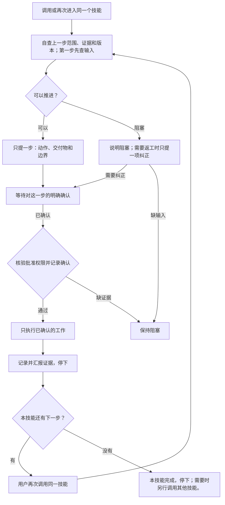

# Let's Grunt

[English](README.md) · 简体中文

先规划，再动工作区；先复核骨架，再写业务逻辑。Let's Grunt 为 Codex 提供四个工作流技能和一个可选的只读复核技能，帮你明确边界、落定契约，并做独立验收。

| 在 Codex 中调用 | 做什么 | 不做什么 |
| --- | --- | --- |
| `$lg-plan` | 只读讨论目标、范围和取舍 | 不写文件，不派发执行 |
| `$lg-spec` | 在授权文档设计架构、API/界面、数据/DDL 和测试方法 | 不写实现、测试、配置或可执行迁移 |
| `$lg-build` | 按锁定的规格实现授权切片，先设计骨架，再独立复核可运行的空函数 | 不跳过独立复核，不把执行权限当成推送或发布权限 |
| `$lg-refine` | 做一项范围明确、保持契约的小改动，执行针对性回归 | 不改契约，不擅自扩范围 |

每次单独进入一个模式。代理先报下一步、交付物和边界；你明确确认这一项后才执行。完成后报告证据并停下。调用技能或同意总体方案不等于批准各步骤。支持 `agents/openai.yaml` 的 Codex 主机上，Spec、Build、Refine 只能显式调用，Plan 保持主机默认。这限制的是技能选择，不是文件访问；要强制规划阶段只读，请使用主机的只读沙箱。

见 [20 步清单及自查规则](skills/lg-spec/references/WORKFLOW.md#numbered-milestones)。提出下一编号前，代理先核对上一步的范围、证据、准确版本和缺口。缺少关键证据就停下；自查不代替独立复核。

## 每个技能都要多轮调用

Plan 有 **3** 步，Spec **6** 步，Build **8** 步，Refine **3** 步。一次调用不会跑完一个模式。已确认的一步做完并停下后，请**再次调用同一个技能**推进下一步。要切换模式，另行调用。



文字版：先自查上一步（第一步查输入），只提一步，等确认，只执行这一项，汇报证据并停下。关键检查失败或缺证据就不推进；需要执行新动作时，只确认具体纠正项。对同一待执行步骤明确确认一次即可，不重复问。

多人协作时，执行前先核验批准人身份与权限，并把准确的确认记录下来。缺少证明或未获授权记录，就保持阻塞。

例如，产品规格做好后，再调用 `$lg-spec`。代理只提出**架构设计**这一步，等你明确确认；做完架构就汇报并停下。再次调用 `$lg-spec` 才推进下一步。Spec 冻结后，另行调用 `$lg-build`。

## 可选：独立复核

在新的独立 Codex 代理或会话中调用 [`$lg-review`](skills/lg-review/SKILL.md)，提供锁定版本、SPEC、授权路径、验收项和证据。单独调用时，先明确确认候选版本、只读范围和复核报告，再开始检查。它标明已验证、未通过、受阻和未运行的部分，并给出核对方法。不改项目、不跑测试，不增加里程碑，也不替代 Build 的独立复测或验收。

## 安装与移除

先查看[五个技能](skills)和[共用工作流](skills/lg-spec/references/WORKFLOW.md)。在 macOS 或 Linux 上，于解包后的目录执行：

```sh
(
  set -eu
  dest="$HOME/.agents/skills"
  for n in lg-plan lg-spec lg-build lg-refine lg-review; do
    if [ -e "$dest/$n" ] || [ -L "$dest/$n" ]; then
      printf 'Already exists; not overwriting: %s\n' "$dest/$n" >&2
      exit 1
    fi
  done
  mkdir -p "$dest"
  for n in lg-plan lg-spec lg-build lg-refine lg-review; do
    cp -R "skills/$n" "$dest/"
  done
)
```

只在某个项目使用时，把目标换成该仓库下 `.agents/skills` 的绝对路径，不要两处都装。五个目录必须同级一起复制，包括 `agents/` 和 `lg-spec/references/WORKFLOW.md`；它们不是分别发包的技能。新开 Codex 会话，确认每个名字只出现一次，然后在临时项目试用 Plan。[Codex 技能文档](https://developers.openai.com/codex/skills)说明发现与调用策略，[Agent Skills 规范](https://agentskills.io/specification)说明文件格式。此项目以 Codex 为目标，其他客户端不在验证范围内。

卸载或升级时，只把这五个已安装的目录移出技能搜索路径，另行备份。不要删除整个技能目录。旧工具不会被此安装改动。

## 找不到命令怎么办

- 在目标项目新开 Codex 会话，确认每个技能目录都含同名 `SKILL.md`，不要把整个解包目录嵌套进技能根。
- 名称重复时检查用户级、项目级技能目录和已启用插件，只留预期的那份。
- 找不到共用工作流时，补回 `lg-spec/references/WORKFLOW.md`，保证五个目录同级。不要把规则复制进项目后绕过检查。

## 用一个小 CLI 试跑

分别在 Codex 输入下面四条，而不是在终端执行：

1. `$lg-plan 规划一个把标题转成短名的本地 CLI；不联网、不持久化、不写文件。`
2. `$lg-spec 只写 docs/SPEC.md，定义 CLI 输入输出、错误、验收及开发和复核交接。`
3. `$lg-build 根据锁定的 CLI 规格，只提出第 10 步骨架设计。` 后续再分别调用，确认空函数、骨架复核、实现、开发自测、独立审查与复测、验收和交付。
4. `$lg-refine 只提出优化现有测试失败消息的范围，不改变 CLI 对外行为。` 范围确认后，再分两轮做改动和跑回归。

[示例骨架和验收矩阵](examples/slug-skeleton/README.md)说明写业务代码前应核对什么。包结构和示例检查：

```sh
python3 scripts/check.py
```

验收时会给出已测版本、验证位置和方法、通过与失败的判断，以及未测范围。例如：在指定版本的 Let's Grunt 仓库根目录，安装 Python 3 后运行 `python3 scripts/check.py`。必测用例必须实际执行并全部通过；报错或跳过必测项都不算通过。这不验证 Codex 的实时行为。

非平凡的跨会话交接可用 [CHANGE.md 模板](skills/lg-spec/references/CHANGE.md)，在授权位置记录已锁定输入、复核证据和下一步。同一会话里的微小变更不用另建文档。跨上下文只传已锁定引用、硬约束和必要证据，独立复核默认不带原聊天或开发结论。

[验证记录](VALIDATION.md)说明实际跑过的检查；维护者可参考[发布核对单](RELEASE-CHECKLIST.md)。

## 许可

[MIT](LICENSE)。
